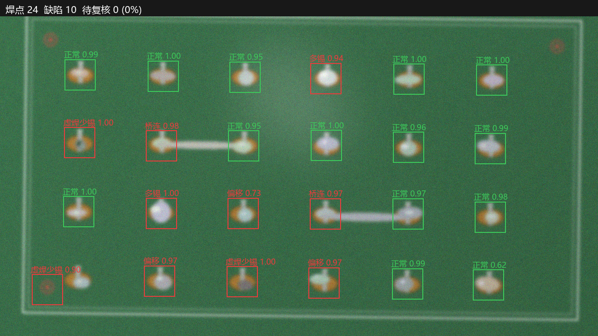
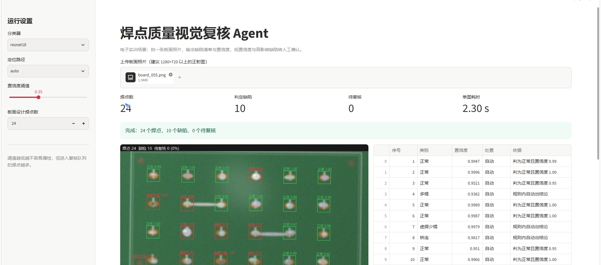
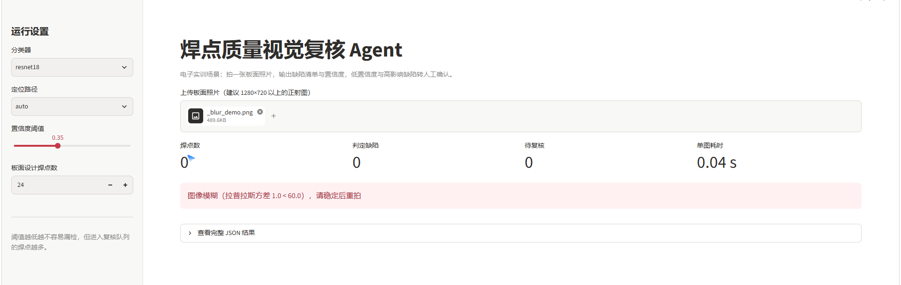
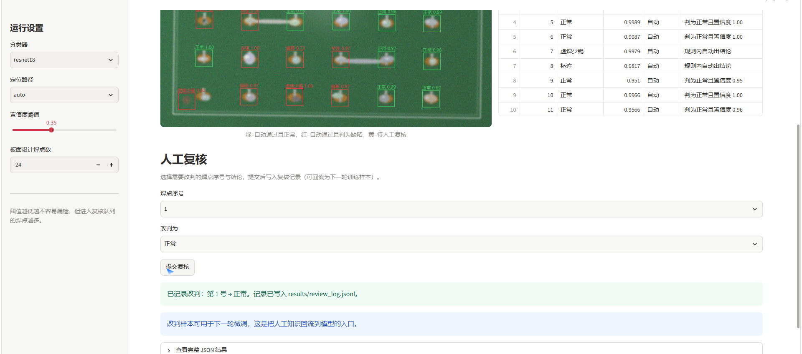
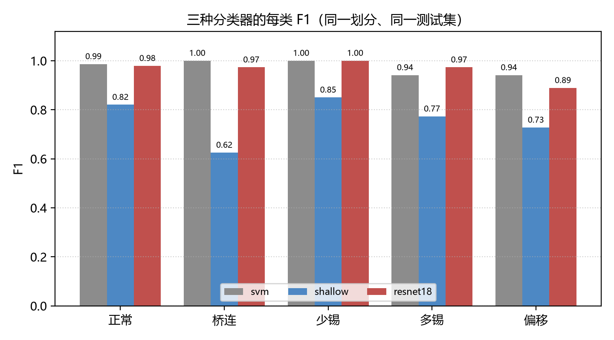
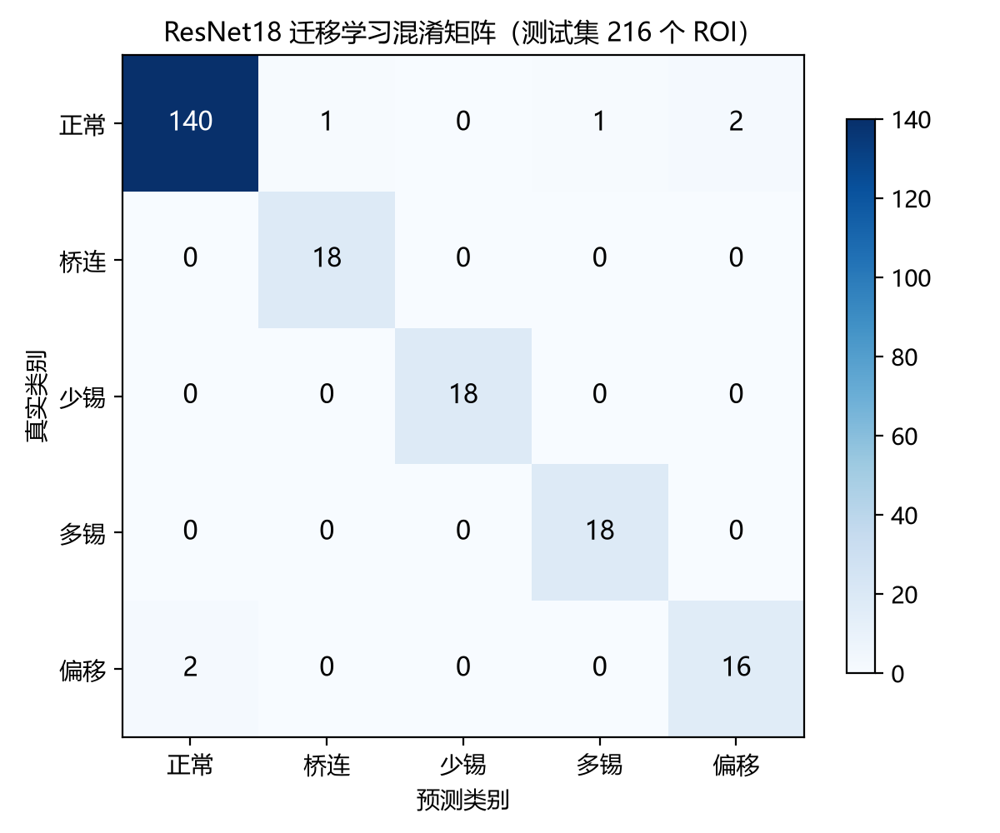
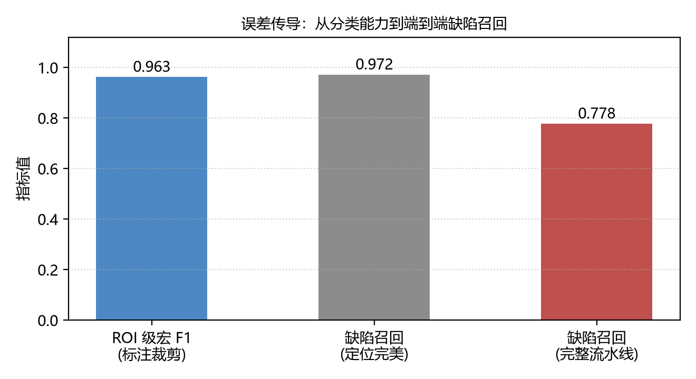
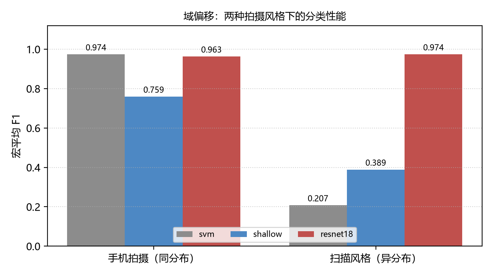
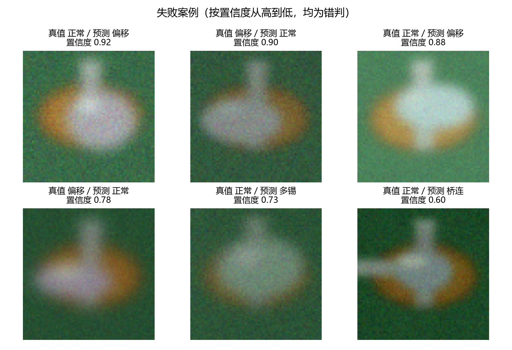

# 焊点质量视觉复核 Agent（面向电子实训）

《机器学习》期末项目 · 学号 028123420 · 李佳



一块焊好的电路板，手机拍一张正射照片，系统自动找出全部焊点、判定每个焊点是正常、桥连、虚焊少锡、多锡还是偏移，把「拿不准」和「高影响」的焊点交给人工复核，最后输出标注图与可留档的 JSON。

项目把「感知 → 判定 → 决策」拆成可分别度量、可分别替换的三段：传统视觉定位、迁移学习分类、置信度路由。任何一段出问题，都能在上游指标里被单独看到，而不是只给一个笼统的准确率。

---

## 一、演示：一次完整运行

界面用 Streamlit 搭建，`streamlit run app/streamlit_app.py` 后上传照片即可。

**1. 上传与结果**：输入文件名、四张指标卡（焊点数 24、判定缺陷 10、待复核 0、单图耗时 2.30 s）、判定消息、标注图与逐点表。



**2. 门控拒收**：同一照片加 σ=4 高斯模糊后上传，界面直接返回重拍建议，不进入推理（指标卡全 0、耗时 0.04 s）。



**3. 人工复核**：对可疑点改判并提交，记录写入 `results/review_log.jsonl`，可回流为下一轮训练样本。



---

## 二、核心结果（测试集，9 块板 / 216 个焊点）

分类（同一划分、同一测试集，逐 ROI 判定）：

| 分类器 | 训练方式 | 宏平均 F1 | 准确率 | 桥连 F1 | 单 ROI 推理 |
|---|---|---|---|---|---|
| HOG+LBP+PCA460+RBF-SVM | 手工特征 + 核方法 | 0.9737 | 0.9815 | 1.000 | 约 8 ms |
| 浅层 CNN（32/64/128/128，40 轮） | 从零训练 | 0.7591 | 0.7870 | 0.625 | 约 3 ms |
| ResNet18 迁移学习（12 轮） | ImageNet 预训练 + 冻结 4 轮后解冻 | 0.9628 | 0.9722 | 0.973 | 约 5 ms |




定位（容差 22 px）：

| 定位路径 | 召回 | 平均中心偏移 | 平均框数 / 设计焊点数 |
|---|---|---|---|
| HSV 双通道分割 | 0.782 | 1.2 px | 23.8 / 24 |
| ＋板面 4×6 网格先验补全 | 0.912 | 1.9 px | 24.0 / 24 |

端到端（定位 → 分类 → 路由，9 块板）：

| 组合 | 焊点召回 | 缺陷召回 | 复核率 | 复核命中率 | 单板耗时（CPU） |
|---|---|---|---|---|---|
| 分割 + SVM | 0.912 | 0.667 | 1.0% | 100% | 0.26 s |
| 分割 + 浅层 CNN | 0.912 | 0.736 | 14.2% | 25.0% | 0.16 s |
| 分割 + ResNet18 | 0.912 | **0.778** | 1.5% | 66.7% | 0.21 s |
| ResNet18（假设定位完美） | 0.912 | 0.972 | 0.5% | 66.7% | — |

域偏移（同模型换到清晰扫描风格，360 个 ROI）：SVM **0.2075**、浅层 CNN **0.3886**、ResNet18 **0.9740**。




**失败案例**（ResNet18 置信度最高的六个错判，标注真值与预测）：



一句话结论：手工特征在同分布精度上与迁移学习接近，但换一种拍摄风格就几乎失效；迁移学习需要预训练权重，换来的是跨拍摄条件稳定。定位是端到端的瓶颈（完美定位下缺陷召回 0.972，实际 0.778）。

> 权重文件（`svm.pkl` 10.5 MB、`resnet18.pt` 42.7 MB、`shallow.pt` 0.9 MB）大于仓库体积上限，未随仓库提交。放到 `weights/` 后即可直接推理，或用下面的 `--retrain` 从头训练。

---

## 三、环境与安装

- Python 3.10+（实测 3.13.18），仅需 CPU；实测机型 i7-13700HX
- 关键依赖：torch 2.15.0+cpu、torchvision 0.29.2+cpu、scikit-learn 1.9.1、opencv-python-headless 5.1.0.95、streamlit 1.67.0

```bash
pip install -r requirements.txt
```

ResNet18 的 ImageNet 权重在第一次训练时自动从 `download.pytorch.org` 下载（约 45 MB），需联网一次，之后走本地缓存。

## 四、运行步骤

### 一条命令复现全流程（本机实测 99.7 s）

```bash
python -m src.run_all --rebuild
```

按「数据生成 → 三段训练 → 评估 → 单图推理」顺序执行；`weights/` 内已有权重时跳过训练，加 `--retrain` 从零重训（约 12 min）。

### 或逐条执行

```bash
# 1 生成合成数据（60 块手机拍摄风格 + 15 块扫描风格，固定随机种子 42）
python -m src.synth_data

# 2 训练三个分类器（SVM 约 76 s，ResNet18 约 200 s，浅层 CNN 约 410 s，均在 CPU）
python -m src.train --only svm
python -m src.train --only resnet18 --epochs 12
python -m src.train --only shallow --epochs 40

# 3 评估：分类、定位、端到端、阈值、域偏移、门控、失败案例，输出 results/eval.json 与 6 张图
python -m src.evaluate

# 4 单张图推理（CLI）
python -m src.agent --image tests/samples/board_055.png --classifier resnet18 --save results/demo

# 5 复核界面
streamlit run app/streamlit_app.py
```

产物：`results/eval.json`（全部指标）、`results/train_metrics.json`（训练曲线数据）、`results/fig_*.png`（报告用图）、`results/demo/annotated_*.png`（标注图）、`results/review_log.jsonl`（界面改判记录）。

## 五、目录结构

```
solder_inspect_agent/
├── src/
│   ├── synth_data.py     # 合成板面与退化、生成 ROI 与标签，按板划分 train/val/test
│   ├── preprocess.py     # 图像读取、质量门控（拉普拉斯方差/过曝/欠曝）、CLAHE、ROI 裁剪
│   ├── features.py       # 自实现 HOG（2020 维）与 LBP（256 维）
│   ├── locate.py         # HSV 双通道定位、网格先验补全、YOLO 接口、全局最优匹配
│   ├── classify.py       # 数据集封装、浅层 CNN、ResNet18 迁移、训练与推理
│   ├── train.py          # 按板划分、类权重、SVM 网格搜索、两种 CNN 训练
│   ├── route.py          # 置信度 + 类别风险 + 类别差距的三段路由
│   ├── agent.py          # 六步流水线、缺失焊点判定、中文标注图、CLI
│   ├── evaluate.py       # 全部评估口径与图表
│   ├── run_all.py        # 一条命令串联数据生成、训练、评估与推理
│   └── build_yolo_dataset.py  # 合成真值转 YOLO 格式（对照实验用）
├── app/streamlit_app.py  # 复核界面：上传、指标卡、改判并写复核记录
├── configs/default.yaml  # 阈值与超参集中配置
├── docs/                 # 组件许可证清单、运行日志、演示说明、示意图
├── tests/samples/        # 3 张可直接试跑的测试板
├── requirements.txt
└── LICENSE               # MIT
```

## 六、数据说明与已知限制

1. **数据为程序化合成，不是实拍。** 真实焊点照片无法获取，`src/synth_data.py` 生成 1280×720 绿色阻焊板、6×4 焊盘阵列、五类缺陷，再叠加下采样、旋转、光照渐变、高光反射、模糊与噪声模拟手机拍摄。坐标、类别、ROI 全部自动记录，固定种子可完全复现。因此本仓库的数字描述「在受控退化条件下的方法行为」，不能直接当成产线良率结论；接入实拍后需重新标定门控与分类阈值。
2. **未使用真实产线数据。** 类别比例为人为设定（每板 16 正常 + 2 桥连 + 2 少锡 + 2 多锡 + 2 偏移），与真实板面分布不同。
3. **定位召回 0.912 仍有 8.8% 焊点未被检出。** 端到端缺陷召回 0.778 与「定位完美」0.972 之间的差距几乎全部来自这一段，见报告第 5 章误差传导。
4. **YOLOv8n 对照实验失败。** 官方预训练权重在本机网络环境下载被重置，只能从零训练，12 轮后验证集 mAP50 为 0，未采用；接口保留在 `YoloLocator`，放入 `weights/yolo_best.pt` 即可切换。详见 `docs/run_log.md`。
5. **门控阈值敏感。** 均匀高斯模糊 σ≥2 时全部拒收（拉普拉斯方差从 431 降到 1.9），能挡住严重失焦，但对轻微失焦偏严格，实拍时需按设备与拍摄距离重新标定。

## 七、许可证

本项目自写代码以 MIT 许可证发布（见 `LICENSE`）。第三方依赖的版本、许可证与来源逐项登记在 `docs/component_license.md`；其中 Ultralytics 为 AGPL-3.0，仅用于对照实验，未分发任何检测器权重。
